<div align="center">
  
</div>

# 🗜️ QuantumCompress (`qc`)

> **Ultra-powerful adaptive hybrid file compressor** built for maximum compression density, multi-threaded performance, and zero-error data integrity.

[](https://www.rust-lang.org)
[](#archive-format-qcx)
[](#4-layer-integrity-guarantee)
[](LICENSE-MIT)

---

## ⚡ Highlights

- **Multi-Algorithm Adaptive Engine**: Dynamically routes data blocks between **LZMA2** (maximum ratio) and **Zstandard** (maximum speed) based on real-time Shannon entropy analysis.
- **Delta Preprocessing Filter**: Automatic detection and byte-difference encoding for continuous/sensor/media streams to maximize compression.
- **Bounded-Memory Streaming**: Compresses and decompresses multi-gigabyte files with bounded RAM usage via chunked batch streaming.
- **Multi-Core Parallelism**: Powered by **Rayon**, automatically distributes block-level compression across all available CPU threads.
- **Desktop GUI Application (`qc-gui`)**: Native GPU-accelerated interface (eframe/egui) with Drag-and-Drop, multi-tab archive management, inspection tables, and benchmark tools.
- **Zero-Error Data Integrity (4-Layer)**:
  1. **Block Layer**: Hardware-accelerated CRC32 per block.
  2. **File Layer**: 256-bit BLAKE3 cryptographic hash per file.
  3. **Archive Layer**: Global SHA-256 trailer validating container integrity.
  4. **Verify-After-Compress**: Automatic round-trip bit-exact validation immediately upon compression.

---

## 🚀 Installation & Building

QuantumCompress is written in 100% memory-safe Rust:

```bash
# Clone and enter workspace
cd e:\PROJECTS\IoT\QuantumCompress

# Build optimized release binaries (CLI + GUI)
cargo build --release

# The executables will be available at:
# CLI: ./target/release/qc.exe
# GUI: ./target/release/qc-gui.exe
```

---

## 🖥️ Graphical User Interface (GUI)

You can launch the GUI in 3 easy ways:
1. Double-click **`target\release\qc-gui.exe`** directly from Windows Explorer.
2. Run `qc gui` from the terminal.
3. Simply double-click **`qc.exe`** without arguments (it will automatically launch the GUI).

### GUI Features:
- 🗜️ **Buat Arsip**: Drag & Drop multiple files or folders, profile picker (Turbo ➔ Quantum), real-time progress & size savings.
- 📂 **Ekstrak Arsip**: Pick any `.qcx` file, preview archive info, and extract to any destination.
- 🔍 **Lihat & Uji Arsip**: Inspect file table, block counts, and run one-click bit-exact integrity tests.
- ⚡ **Benchmark Profil**: Test and compare performance across profiles on any data.

---

## 📖 CLI Usage

```text
QuantumCompress (QC) is an adaptive multi-algorithm compression engine.

Usage: qc <COMMAND>

Commands:
  compress   Compress files or directories into a .qcx archive [aliases: c, a]
  extract    Extract an archive into a target directory [aliases: x, d]
  list       List the contents of a .qcx archive [aliases: l]
  test       Test the integrity of a .qcx archive without extracting [aliases: t]
  bench      Benchmark compression profiles on a given file or directory [aliases: b]
  help       Print help
```

### 1. Compress Files or Folders

```bash
# Basic compression (default: Normal profile with automatic verification)
qc compress my_folder -o archive.qcx

# Maximum compression (Ultra profile, 8 MB blocks, LZMA2 preset 9)
qc compress large_file.iso -o backup.qcx -p ultra

# Fastest compression (Turbo profile, 1 MB blocks, Zstandard)
qc compress logs_directory -o logs.qcx -p turbo

# Specify custom worker thread count
qc compress dataset -o data.qcx -p normal -t 8
```

### 2. Extract Archive

```bash
# Extract to current directory
qc extract archive.qcx

# Extract to specific output directory
qc extract archive.qcx -o ./restored_data
```

### 3. List Archive Contents

```bash
qc list archive.qcx
```

### 4. Test Archive Integrity (Without Extracting)

```bash
qc test archive.qcx
```

### 5. Benchmark Profiles

```bash
qc bench ./my_dataset
```

---

## 🎛️ Compression Profiles

| Profile | Primary Algorithm | Level | Block Size | Best For |
|:---|:---|:---:|:---:|:---|
| 🚀 `turbo` | Zstandard | 1 | 1 MB | Rapid backups, high-speed streaming |
| ⚡ `fast` | Zstandard | 10 | 2 MB | Everyday balanced compression |
| 📦 `normal` | LZMA2 / Zstd (Adaptive) | 6 | 4 MB | General software distribution, backups |
| 💎 `ultra` | LZMA2 | 9 | 8 MB | Archival storage, maximum space saving |
| 🔬 `quantum` | LZMA2 + Large Window | 9 | 16 MB | Cold storage, extreme space reduction |

---

## 📦 Archive Format: `.qcx` (v1)

```text
┌─────────────────────────────────────────────────────────────────┐
│ MAGIC: 4 bytes  "QCX\x01"                                       │
│ FORMAT_VERSION: u16 Little-Endian                               │
│ METADATA_COMPRESSED_LEN: u64 Little-Endian                       │
│ METADATA: Zstandard-compressed bincode payload                  │
│   ├── FileEntry[0]: path, size, blake3_hash, block_start, etc.  │
│   ├── FileEntry[1]: ...                                         │
│   └── Profile, total files, dirs, total original bytes          │
├─────────────────────────────────────────────────────────────────┤
│ BLOCK 0:                                                        │
│   ├── HEADER_LEN: u32 Little-Endian                             │
│   ├── BlockHeader: algo, preprocessor, original_sz, crc32       │
│   └── PAYLOAD: Compressed byte stream                           │
│ BLOCK 1: ...                                                    │
│ BLOCK N: ...                                                    │
├─────────────────────────────────────────────────────────────────┤
│ ARCHIVE_SHA256: 32 bytes (Trailer verifying bytes 0..EOF-32)    │
└─────────────────────────────────────────────────────────────────┘
```

---

## 🛡️ 4-Layer Integrity Guarantee

1. **Hardware-Accelerated CRC32**: Every compressed block stores the CRC32 of its uncompressed data. Decompression aborts immediately if a bit flip is detected in any block.
2. **BLAKE3 Per-File Verification**: Every reconstructed file is streamed into a 256-bit BLAKE3 hasher and compared against the recorded signature.
3. **SHA-256 Trailer**: Validates the overall archive file against corruption or tampering.
4. **Immediate Round-Trip Validation**: Every `qc compress` operation automatically runs an end-to-end verification pass before exiting.

## License

Licensed under either of [MIT](LICENSE-MIT) or [Apache-2.0](LICENSE-APACHE) at your option.
